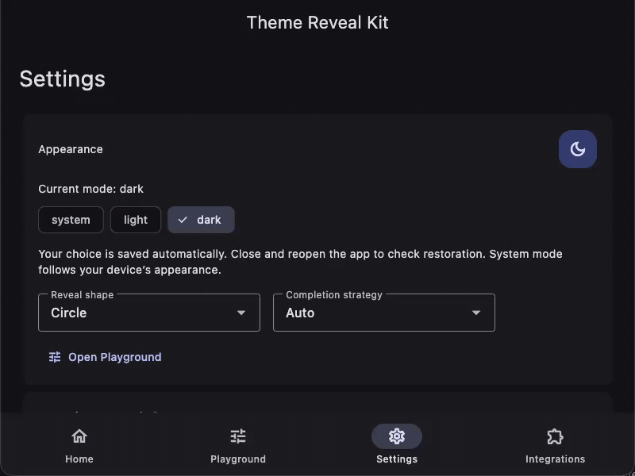
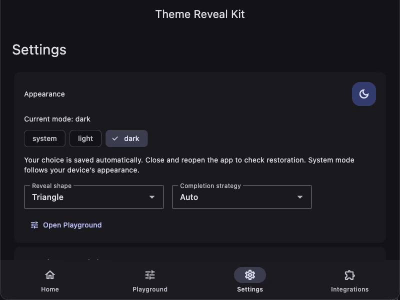
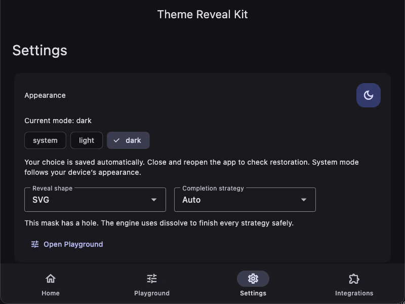
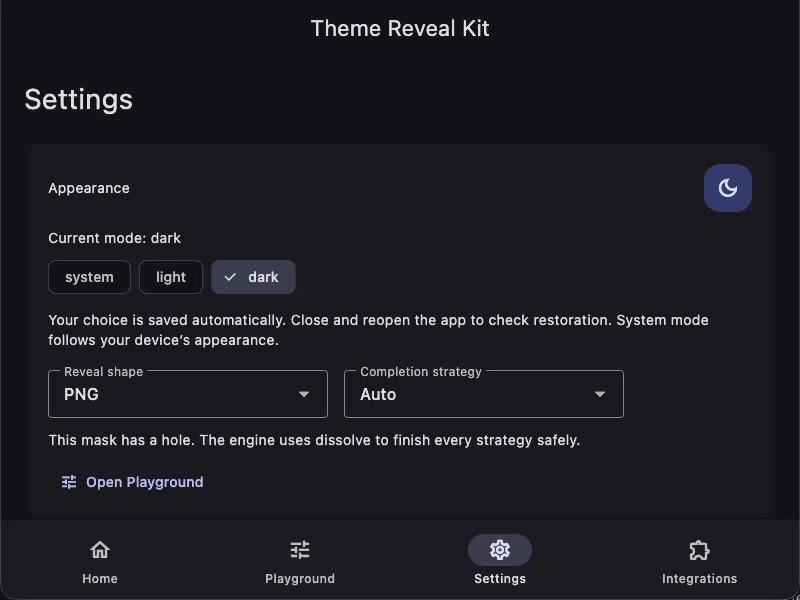
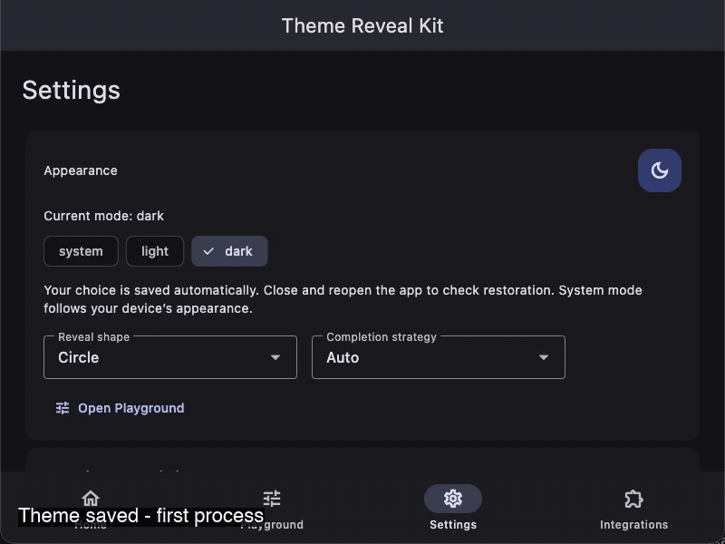

# Theme Reveal Kit

Persistent light, dark and system themes with reveals from any widget.

<a href="https://pub.dev/packages/theme_reveal_kit"></a>
<a href="https://pub.dev/packages/theme_reveal_kit/score"></a>
<a href="https://pub.dev/packages/theme_reveal_kit/score"></a>
<a href="https://github.com/Ahmedelsapagh10/theme_reveal/blob/master/LICENSE"></a>
<a href="https://pub.dev/packages/theme_reveal_kit"></a>



[Install](#install) · [Modes](#pick-your-mode) · [Managed](#managed) ·
[External](#external) · [Buttons](#buttons-in-screens) · [Shapes](#reveal-shapes) ·
[Animation](#animation-config) · [Control](#programmatic-control) ·
[Selector](#lightdarksystem-selector) · [Storage](#custom-storage-and-persistence) ·
[Troubleshooting](#troubleshooting) · [Platforms](#platform-support)

## Install

```sh
# Add the package to your Flutter app.
flutter pub add theme_reveal_kit
```

Add these imports to screens using the recipes below.

<!-- snippet:imports -->
```dart
// Add these imports to every screen using the recipes below.
import 'package:flutter/material.dart';
import 'package:theme_reveal_kit/theme_reveal_kit.dart';
```

The widgets are ready to use with Flutter 3.41.0+ and Dart 3.11.0+.

## Pick your mode

| Your app today | Use |
| --- | --- |
| No theme system | Managed |
| Existing Cubit/Bloc/Provider/Riverpod/GetX/ValueNotifier or saved preference | External |

Never use both: one owner manages your theme and saved preference.

## Managed

Replace `main.dart` with this complete file. Keep all three settings passed to `MaterialApp`.

<!-- snippet:managed -->
```dart
// 1) Import Flutter and Theme Reveal Kit.
import 'package:flutter/material.dart';
import 'package:theme_reveal_kit/theme_reveal_kit.dart';

Future<void> main() async {
  // 2) Restore the saved preference before showing the app.
  WidgetsFlutterBinding.ensureInitialized();
  final controller = await RevealThemeController.create();
  // 3) Keep the controller for the app lifetime; dispose widget-owned controllers.
  runApp(
    RevealThemeBuilder(
      controller: controller,
      builder: (context, settings) => MaterialApp(
        // YOUR CODE: replace these themes and the home screen.
        theme: ThemeData.light(),
        darkTheme: ThemeData.dark(),
        // 4) Keep all three settings below.
        themeMode: settings.themeMode,
        themeAnimationDuration: settings.themeAnimationDuration,
        builder: settings.builder,
        home: Scaffold(
          body: Center(child: RevealThemeButton(controller: controller)),
        ),
      ),
    ),
  );
}
```

The saved mode appears at startup, and the button switches themes with a circular reveal.

## External

Keep your existing theme state and persistence. Add the viewport and change state inside `onThemeChange`.

### MaterialApp setup

Use this complete widget file from your existing state builder: pass the current `mode` and your `changeTheme` callback.

<!-- snippet:external_setup -->
```dart
// 1) Import Flutter and the reveal widgets.
import 'package:flutter/material.dart';
import 'package:theme_reveal_kit/theme_reveal_kit.dart';

// 2) Pass your current state and update callback from your state builder.
class ExternalThemeApp extends StatelessWidget {
  const ExternalThemeApp({
    super.key,
    required this.mode,
    required this.changeTheme,
  });
  final ThemeMode mode;
  final VoidCallback changeTheme;
  @override
  Widget build(BuildContext context) => MaterialApp(
    // YOUR CODE: supply your themes and home screen.
    theme: ThemeData.light(),
    darkTheme: ThemeData.dark(),
    themeMode: mode,
    // 3) Keep zero duration and the viewport builder.
    themeAnimationDuration: Duration.zero,
    builder: (context, child) => ThemeRevealViewport(child: child!),
    home: Scaffold(
      body: Builder(
        builder: (buttonContext) => FilledButton(
          // 4) Change existing state only inside this callback.
          onPressed: () => ThemeRevealViewport.of(
            buttonContext,
          ).reveal(from: buttonContext, onThemeChange: changeTheme),
          child: const Text('Change theme'),
        ),
      ),
    ),
  );
}
```

Your existing state chooses the theme; the button adds the reveal.

### Button in an existing screen

Put this below your viewport. Replace `changeTheme` with the callback that updates your current state.

<!-- snippet:external_button -->
```dart
// Put this button below ThemeRevealViewport in your home screen.
// YOUR CODE: changeTheme updates your existing theme state.
Builder(
  builder: (buttonContext) => FilledButton(
    onPressed: () => ThemeRevealViewport.of(
      buttonContext,
    ).reveal(from: buttonContext, onThemeChange: changeTheme),
    child: const Text('Change theme'),
  ),
)
```

The state changes only when the reveal request is accepted.

### Cubit app

Add [flutter_bloc](https://pub.dev/packages/flutter_bloc) to your app, then use this complete `main.dart`.

<!-- snippet:cubit -->
```dart
// 1) Import flutter_bloc along with Flutter and Theme Reveal Kit.
import 'package:flutter/material.dart';
import 'package:theme_reveal_kit/theme_reveal_kit.dart';
import 'package:flutter_bloc/flutter_bloc.dart';

void main() => runApp(const CubitThemeApp());

class ThemeCubit extends Cubit<ThemeMode> {
  ThemeCubit() : super(ThemeMode.system);
  // YOUR CODE: keep your existing persistence when emitting a new preference.
  void toggle() =>
      emit(state == ThemeMode.dark ? ThemeMode.light : ThemeMode.dark);
}

class CubitThemeApp extends StatelessWidget {
  const CubitThemeApp({super.key});
  @override
  Widget build(BuildContext context) => BlocProvider(
    // 2) BlocProvider owns and closes this Cubit.
    create: (_) => ThemeCubit(),
    child: BlocBuilder<ThemeCubit, ThemeMode>(
      builder: (context, mode) => MaterialApp(
        // YOUR CODE: replace themes and screen content.
        theme: ThemeData.light(),
        darkTheme: ThemeData.dark(),
        themeMode: mode,
        // 3) Keep the viewport and zero theme animation duration.
        themeAnimationDuration: Duration.zero,
        builder: (context, child) => ThemeRevealViewport(child: child!),
        home: Scaffold(
          body: Builder(
            builder: (buttonContext) => FilledButton(
              // 4) Emit only inside the accepted theme change callback.
              onPressed: () => ThemeRevealViewport.of(buttonContext).reveal(
                from: buttonContext,
                onThemeChange: () => buttonContext.read<ThemeCubit>().toggle(),
              ),
              child: const Text('Change theme'),
            ),
          ),
        ),
      ),
    ),
  );
}
```

The Cubit emits light or dark inside the reveal callback, and BlocBuilder updates the app.

### ValueNotifier app

Use this complete `main.dart` when a ValueNotifier owns your theme.

<!-- snippet:notifier -->
```dart
// 1) Import the widgets and start the app.
import 'package:flutter/material.dart';
import 'package:theme_reveal_kit/theme_reveal_kit.dart';

void main() => runApp(const NotifierThemeApp());

class NotifierThemeApp extends StatefulWidget {
  const NotifierThemeApp({super.key});
  @override
  State<NotifierThemeApp> createState() => _NotifierThemeAppState();
}

class _NotifierThemeAppState extends State<NotifierThemeApp> {
  // 2) This notifier owns the preference; add your persistence here if needed.
  final mode = ValueNotifier(ThemeMode.system);
  @override
  void dispose() {
    mode.dispose();
    super.dispose();
  }

  @override
  Widget build(BuildContext context) => ValueListenableBuilder(
    valueListenable: mode,
    builder: (context, value, _) => MaterialApp(
      // YOUR CODE: replace the themes and screen content.
      theme: ThemeData.light(),
      darkTheme: ThemeData.dark(),
      themeMode: value,
      // 3) Keep the viewport and disable competing theme interpolation.
      themeAnimationDuration: Duration.zero,
      builder: (context, child) => ThemeRevealViewport(child: child!),
      home: Scaffold(
        body: Builder(
          builder: (buttonContext) => FilledButton(
            // 4) Update the notifier only inside onThemeChange.
            onPressed: () => ThemeRevealViewport.of(buttonContext).reveal(
              from: buttonContext,
              onThemeChange: () => mode.value = value == ThemeMode.dark
                  ? ThemeMode.light
                  : ThemeMode.dark,
            ),
            child: const Text('Change theme'),
          ),
        ),
      ),
    ),
  );
}
```

The app changes theme through the notifier and disposes it when the widget is removed.

### Migrating an existing app

1. Keep your existing theme state and saved preference.
2. Bind that state to `MaterialApp.themeMode` and supply both themes.
3. Install `ThemeRevealViewport` in `MaterialApp.builder` and set `themeAnimationDuration: Duration.zero`.
4. Move your state update inside `onThemeChange`, using a context below the viewport.
5. Remove competing theme animations; keep the managed controller and builder out of this integration.

## Buttons in screens

Use the controller created in managed `main.dart`.

### Settings page

Add this complete widget file and open `SettingsPage(controller: controller)` below your managed MaterialApp.

<!-- snippet:settings -->
```dart
// 1) Use the controller restored in your managed main.dart.
import 'package:flutter/material.dart';
import 'package:theme_reveal_kit/theme_reveal_kit.dart';

class SettingsPage extends StatelessWidget {
  const SettingsPage({super.key, required this.controller});
  final RevealThemeController controller;
  @override
  Widget build(BuildContext context) => Scaffold(
    // YOUR CODE: replace the title and add your other settings.
    appBar: AppBar(title: const Text('Settings')),
    body: ListTile(
      title: const Text('Appearance'),
      // 2) Keep this page below the managed MaterialApp.
      trailing: RevealThemeButton(controller: controller),
    ),
  );
}
```

The Appearance row switches themes without leaving Settings.

### AppBar action

Use this Scaffold as your screen.

<!-- snippet:appbar -->
```dart
// Put this in your screen below the managed MaterialApp.
// controller is the one you created in main().
Scaffold(
  appBar: AppBar(
    title: const Text('Home'),
    actions: [RevealThemeButton(controller: controller)],
  ),
  body: const Center(child: Text('Welcome')),
)
```

The action reveals from the app bar.

### Drawer tile

Use this Scaffold as your screen and open its drawer.

<!-- snippet:drawer -->
```dart
// Put this in your screen below the managed MaterialApp.
// controller is the one you created in main().
Scaffold(
  appBar: AppBar(title: const Text('Home')),
  drawer: Drawer(
    child: SafeArea(
      child: ListTile(
        title: const Text('Appearance'),
        trailing: RevealThemeButton(controller: controller),
      ),
    ),
  ),
  body: const Center(child: Text('Open the drawer')),
)
```

The drawer contains an Appearance toggle.

### Floating position

Use this Scaffold as your screen.

<!-- snippet:floating -->
```dart
// Put this in your screen below the managed MaterialApp.
// controller is the one you created in main().
Scaffold(
  body: const Center(child: Text('Home')),
  floatingActionButton: RevealThemeButton(controller: controller),
  floatingActionButtonLocation: FloatingActionButtonLocation.endFloat,
)
```

The theme toggle floats at the bottom end.

### Any custom widget

Put this where your custom theme control belongs.

<!-- snippet:trigger -->
```dart
// Put this in your screen below the managed MaterialApp.
// controller is the one you created in main().
RevealThemeTrigger(
  controller: controller,
  semanticLabel: 'Change appearance',
  child: const Chip(avatar: Icon(Icons.contrast), label: Text('Appearance')),
)
```

The chip supports tap, keyboard and screen-reader activation.

## Reveal shapes

Put any of these widgets below your managed MaterialApp; reuse the same controller.



### Circle (default)

Put this in your screen in place of the default theme button.

<!-- snippet:circle -->
```dart
// Put this in your screen below the managed MaterialApp.
// controller is the one you created in main().
RevealThemeButton(controller: controller, revealShape: const RevealShape.circle())
```

The reveal expands as a circle; omit revealShape for the same default.

### Triangle

Put this in your screen in place of the default theme button.

<!-- snippet:triangle -->
```dart
// Put this in your screen below the managed MaterialApp.
// controller is the one you created in main().
RevealThemeButton(controller: controller, revealShape: const RevealShape.triangle())
```

The reveal expands as a triangle.

### Star

Put this in your screen in place of the default theme button.

<!-- snippet:star -->
```dart
// Put this in your screen below the managed MaterialApp.
// controller is the one you created in main().
RevealThemeButton(
  controller: controller,
  revealShape: const RevealShape.star(points: 5, innerRadius: .45),
)
```

The reveal expands as a five-point star.

### Heart

Put this in your screen in place of the default theme button.

<!-- snippet:heart -->
```dart
// Put this in your screen below the managed MaterialApp.
// controller is the one you created in main().
RevealThemeButton(controller: controller, revealShape: const RevealShape.heart())
```

The reveal expands as a heart.

### Rounded rectangle

Put this in your screen in place of the default theme button.

<!-- snippet:rounded -->
```dart
// Put this in your screen below the managed MaterialApp.
// controller is the one you created in main().
RevealThemeButton(
  controller: controller,
  revealShape: const RevealShape.roundedRectangle(aspectRatio: 1.5, cornerRadius: .16),
)
```

The reveal expands as a rounded rectangle.

### Icon

Put this in your screen in place of the default theme button.

<!-- snippet:icon -->
```dart
// Put this in your screen below the managed MaterialApp.
// controller is the one you created in main().
RevealThemeButton(controller: controller, revealShape: const RevealShape.icon(Icons.favorite))
```

The loaded icon glyph becomes the reveal shape; load custom fonts first.

### SVG

Put this in your screen and add the asset entry below.

<!-- snippet:svg -->
```dart
// Put this in your screen below the managed MaterialApp.
// controller is the one you created in main().
RevealThemeButton(
  controller: controller,
  revealShape: const RevealShape.svgAsset('assets/logo.svg'),
)
```

Filled SVG paths become the silhouette; convert unsupported strokes or text to filled paths.

```yaml
# Add this to your pubspec.yaml and put the file at that path
flutter:
  assets:
    - assets/logo.svg
```



### PNG

Put this in your screen and add the asset entry below.

<!-- snippet:png -->
```dart
// Put this in your screen below the managed MaterialApp.
// controller is the one you created in main().
RevealThemeButton(
  controller: controller,
  revealShape: const RevealShape.pngAsset('assets/logo.png', alphaThreshold: 32, trim: true),
)
```

Transparent pixels stay outside the reveal; an opaque PNG produces a rectangle.

```yaml
# Add this to your pubspec.yaml and put the file at that path
flutter:
  assets:
    - assets/logo.png
```



### JSON

Put this in your screen and add the asset entry below.

<!-- snippet:json -->
```dart
// Put this in your screen below the managed MaterialApp.
// controller is the one you created in main().
RevealThemeButton(
  controller: controller,
  revealShape: const RevealShape.jsonAsset('assets/custom_shape.json'),
)
```

The JSON document chooses the reveal geometry.

```yaml
# Add this to your pubspec.yaml and put the file at that path
flutter:
  assets:
    - assets/custom_shape.json
```

Use this content for `assets/custom_shape.json`: `{"type":"shape","shape":"star","parameters":{"points":5,"innerRadius":0.45}}`.

### Custom Path

Put this in your screen; draw your own geometry with the supplied size.

<!-- snippet:path -->
```dart
// Put this in your screen below the managed MaterialApp.
// controller is the one you created in main().
RevealThemeButton(
  controller: controller,
  revealShape: RevealShape.customPath(
    builder: (size) => Path()
      ..moveTo(size.width / 2, 0)
      ..lineTo(size.width, size.height / 2)
      ..lineTo(size.width / 2, size.height)
      ..lineTo(0, size.height / 2)
      ..close(),
  ),
)
```

The path produces a diamond-shaped reveal.

## Animation config

Put this button in your screen and adjust its animation fields.

<!-- snippet:config -->
```dart
// Put this in your screen below the managed MaterialApp.
// controller is the one you created in main().
RevealThemeButton(
  controller: controller,
  revealShape: const RevealShape.star(),
  animation: const RevealAnimationConfig(
    duration: Duration(milliseconds: 900),
    curve: Curves.easeInOutCubic,
    origin: RevealOrigin.gesture(),
    completionStrategy: RevealCompletionStrategy.expandAndDissolve,
    reducedMotion: RevealReducedMotion.system,
  ),
)
```

The star expands for 900 ms from the tap and dissolves at completion; system reduced motion applies instantly.

## Programmatic control

Call these alternatives from a callback. Use the controller created in managed mode and a context below the viewport.

Select a specific mode immediately.

<!-- snippet:set -->
```dart
// Call from onPressed with a context below the viewport. Select dark mode immediately.
controller.setThemeMode(ThemeMode.dark);
```

The app becomes dark.

Toggle without a reveal.

<!-- snippet:toggle -->
```dart
// Call from onPressed with a context below the viewport. Switch light/dark immediately.
controller.toggleTheme();
```

Light switches to dark, or dark to light.

Return to system mode immediately.

<!-- snippet:reset -->
```dart
// Call from onPressed with a context below the viewport. Follow device brightness immediately.
controller.resetToSystem();
```

The app follows device brightness.

Select dark mode with a reveal.

<!-- snippet:reveal_set -->
```dart
// Call from onPressed with a context below the viewport. Reveal dark mode.
ThemeRevealViewport.of(context).setThemeMode(controller, ThemeMode.dark, from: context);
```

The new dark theme expands from the supplied context.

Toggle with a reveal.

<!-- snippet:reveal_toggle -->
```dart
// Call from onPressed with a context below the viewport. Reveal the opposite light/dark mode.
ThemeRevealViewport.of(context).toggleTheme(controller, from: context);
```

The opposite theme expands from the supplied context.

Return to system mode with a reveal.

<!-- snippet:reveal_reset -->
```dart
// Call from onPressed with a context below the viewport. Reveal the system theme and follow device brightness.
ThemeRevealViewport.of(context).setThemeMode(controller, ThemeMode.system, from: context);
```

The reveal shows the device theme and keeps following device brightness.

Reveal from the screen center.

<!-- snippet:center -->
```dart
// Call from onPressed below the viewport; reveal from the screen center.
ThemeRevealViewport.of(context).toggleTheme(
  controller,
  from: context,
  config: const RevealAnimationConfig(origin: RevealOrigin.screenCenter()),
);
```

The opposite theme expands from the middle of the viewport.

### GlobalKey origin

Keep `final anchor = GlobalKey()` in your screen State, then attach it to a widget.

<!-- snippet:key_anchor -->
```dart
// Put this widget in your screen; keep final anchor = GlobalKey() in its State.
Text('Reveal starts here', key: anchor)
```

This text becomes the origin for the next call.

Call from an onPressed in the same screen.

<!-- snippet:key_call -->
```dart
// Call from onPressed; anchor is the GlobalKey attached to the widget above.
ThemeRevealViewport.of(context).toggleTheme(
  controller,
  from: context,
  config: RevealAnimationConfig(origin: RevealOrigin.fromKey(anchor)),
);
```

The reveal expands from the keyed text.

## Light/Dark/System selector

Put this below your managed viewport.

<!-- snippet:selector -->
```dart
// Put this in your screen below the managed MaterialApp.
// controller is the one you created in main().
ListenableBuilder(
  listenable: controller,
  builder: (context, _) => SegmentedButton<ThemeMode>(
    segments: const [
      ButtonSegment(value: ThemeMode.light, label: Text('Light')),
      ButtonSegment(value: ThemeMode.dark, label: Text('Dark')),
      ButtonSegment(value: ThemeMode.system, label: Text('System')),
    ],
    selected: {controller.themeMode},
    onSelectionChanged: (selection) => ThemeRevealViewport.of(
      context,
    ).setThemeMode(controller, selection.single, from: context),
  ),
)
```

Selecting System follows device brightness; Light and Dark select explicit modes.

## Custom storage and persistence

Add this complete class file when you want to use your own asynchronous string storage.

<!-- snippet:storage -->
```dart
// 1) Connect your own asynchronous string storage through these callbacks.
import 'package:flutter/material.dart';
import 'package:theme_reveal_kit/theme_reveal_kit.dart';

class AppThemeStorage implements ThemeStorage {
  AppThemeStorage({required this.load, required this.save});
  final Future<String?> Function() load;
  final Future<void> Function(String) save;
  @override
  Future<ThemeMode?> read() async => ThemeModeCodec.decode(await load());
  @override
  Future<void> write(ThemeMode mode) => save(ThemeModeCodec.encode(mode));
}
```

Your callbacks read and write the strings `light`, `dark` or `system`.

In main(), create your adapter and restore it before calling runApp.

<!-- snippet:restore -->
```dart
// 2) In main(), initialize bindings and await this before runApp.
// YOUR CODE: pass AppThemeStorage(load: yourRead, save: yourWrite) as storage.
WidgetsFlutterBinding.ensureInitialized();
final controller = await RevealThemeController.create(
  storage: storage,
  defaultMode: ThemeMode.system,
  onPersistenceError: (error, stack) => debugPrint('Theme storage: $error'),
);
```

The restored mode appears before the first frame; missing or invalid data uses defaultMode.

Wait for a write when you need its result.

<!-- snippet:persistence -->
```dart
// In an async callback, save dark mode and wait for the write to finish.
controller.setThemeMode(ThemeMode.dark);
await controller.flush();
if (controller.lastPersistenceError != null) {
  debugPrint('Theme preference could not be saved');
}
```

Storage errors reach onPersistenceError and lastPersistenceError without reverting the visible theme.

Reload after another part of your app edits the saved preference.

<!-- snippet:reload -->
```dart
// Read the preference again after another part of your app changes storage.
await controller.reloadFromStorage();
```

The app picks up the stored value.

Managed mode defaults to SharedPreferencesAsync. Old SharedPreferences values are not shared automatically; keep existing preferences in external mode or supply a compatible backend. `legacyBoolKey` only migrates accessible boolean flags.



## Troubleshooting

- **Theme unchanged →** bind `themeMode` to the changing state and supply both themes.
- **No animation →** install the viewport and check enabled, duration and reduced-motion settings.
- **Wrong origin →** pass a context below the viewport; use gesture origin for pointer coordinates.
- **Opaque PNG rectangle →** supply an image with real transparency.
- **Repeated taps ignored →** use `RevealRepeatPolicy.queueLatest` to retain the latest pending request.
- **Native map/video missing →** platform views and system UI are not included; test your target composition.
- **Theme changes late →** finish `onThemeChange` after the new state is emitted; await asynchronous updates and disable MaterialApp theme animation.
- **Asset missing →** declare the file under `flutter.assets` and check its name and case.
- **SVG differs →** use filled paths or export a transparent PNG for unsupported SVG features.

## Platform support

| Platform | Status |
| --- | --- |
| macOS | Verified |
| Android | Unverified |
| iOS | Unverified |
| Web | Unverified |
| Windows / Linux | Unverified |

Ahmed Elsapagh · [Portfolio](https://elsapagh.octopusteam.net/)

[MIT License](https://github.com/Ahmedelsapagh10/theme_reveal/blob/master/LICENSE) © 2026 Ahmed Elsapagh

[Contributing](https://github.com/Ahmedelsapagh10/theme_reveal/blob/master/CONTRIBUTING.md)

[Example](https://github.com/Ahmedelsapagh10/theme_reveal/tree/master/example)

[Repository](https://github.com/Ahmedelsapagh10/theme_reveal) · [Issue tracker](https://github.com/Ahmedelsapagh10/theme_reveal/issues)
