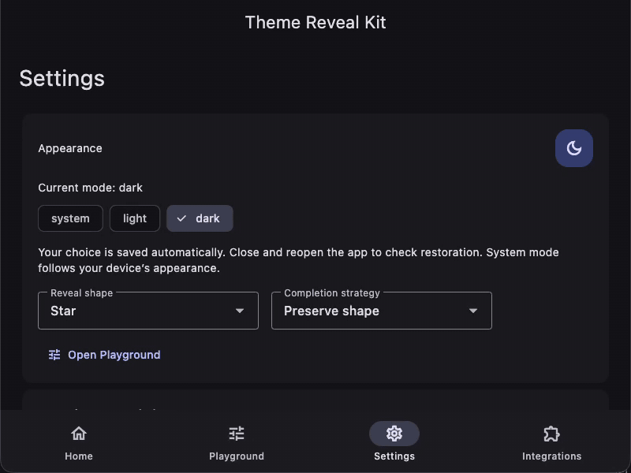
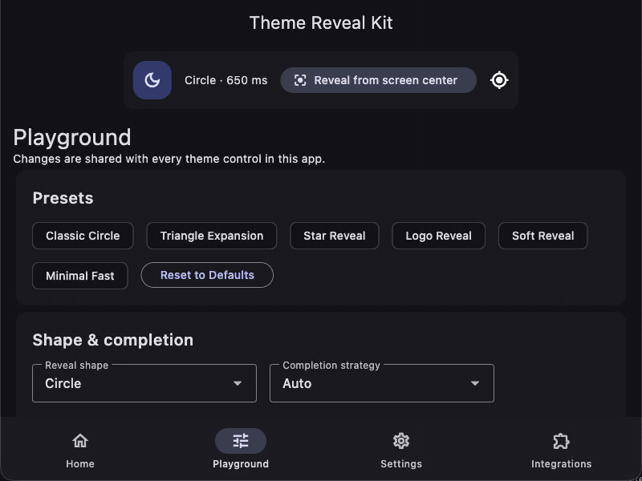
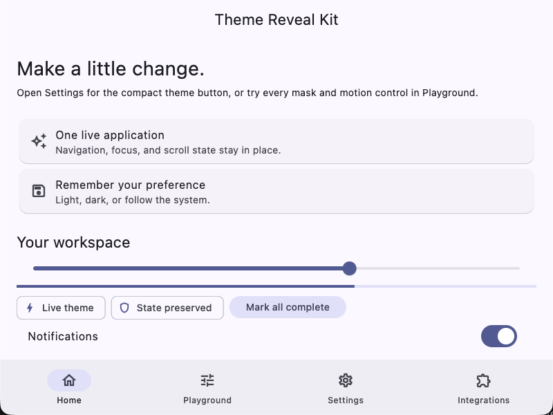
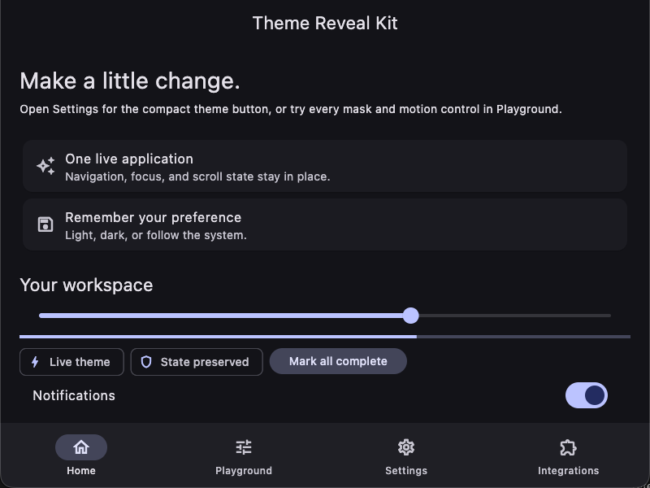
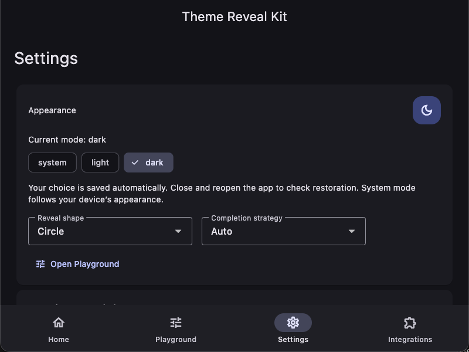

# Theme Reveal Kit

**Persistent Flutter themes with reveals that expose your real, live app.**


Local release candidate **0.1.0**; not published to pub.dev. The badge does not
claim a hosted version. Android, iOS and web are unverified.

<p align="center">
  
</p>

Made by [Ahmed Elsapagh](https://elsapagh.octopusteam.net/).

<details>
<summary>Contents</summary>

- [Why Theme Reveal Kit](#why-theme-reveal-kit)
- [Quick start](#quick-start)
- [Visual gallery](#visual-gallery)
- [Feature matrix](#feature-matrix)
- [Cookbook](#cookbook)
- [Persistence](#persistence)
- [External state management](#external-state-management)
- [Three independent concepts](#three-independent-concepts)
- [Completion strategies](#completion-strategies)
- [SVG support and JSON schema](#svg-support-and-json-schema)
- [Accessibility and reduced motion](#accessibility-and-reduced-motion)
- [Platform support and verification](#platform-support-and-verification)
- [Limitations](#limitations)
- [Troubleshooting](#troubleshooting)
- [Run the example](#run-the-example)
- [Contributing](#contributing)
- [About the author](#about-the-author)
- [License](#license)

</details>

## Why Theme Reveal Kit

- **A circle by default.** Add a button; choose custom masks when you need them.
- **One live app.** Navigation, scroll and widget state stay mounted beneath the old-frame overlay.
- **Persistence included.** Restore Light/Dark/System before the first frame.
- **Your silhouette.** Use vectors, Path, icon glyphs, transparent PNG, SVG or JSON.
- **Your state model.** Use the controller or an external state-emitting callback.

## Quick start

Requires Flutter **3.41.0+** and Dart **3.11.0+**. While this candidate is
unpublished, depend on your local checkout:

```yaml
dependencies:
  theme_reveal_kit:
    path: ../theme_reveal
```

Once 0.1.0 is published, replace the path entry with `theme_reveal_kit: ^0.1.0`.
Run `flutter pub get`, then use this complete `main.dart`:

```dart
import 'package:flutter/material.dart';
import 'package:theme_reveal_kit/theme_reveal_kit.dart';

Future<void> main() async {
  WidgetsFlutterBinding.ensureInitialized();
  final controller = await RevealThemeController.create();
  runApp(
    RevealThemeBuilder(
      controller: controller,
      builder: (context, settings) => MaterialApp(
        theme: ThemeData.light(),
        darkTheme: ThemeData.dark(),
        themeMode: settings.themeMode,
        themeAnimationDuration: settings.themeAnimationDuration,
        builder: settings.builder,
        home: Scaffold(
          body: Center(child: RevealThemeButton(controller: controller)),
        ),
      ),
    ),
  );
}
```

Tap the moon/sun button.  
The real app changes theme beneath a circular cutout from the button.  
Restart the app: its saved theme is restored before the first frame.

Pass **all three** settings to MaterialApp. The zero duration disables competing
implicit theme interpolation. This minimal process-lifetime controller is shown
for startup; dispose controllers you create in a longer-lived widget owner.

Every Dart block is copied from compiled example sources and checked by
[the snippet tests](https://github.com/Ahmedelsapagh10/theme_reveal/blob/master/example/test/readme_snippets_test.dart).

## Visual gallery

These are recordings of the real macOS example, not mock-ups. The same native
app and engine drive the screenshots and every GIF. Recorded UI labels identify
the selected shape/strategy. Persistence uses two real processes with an explicit
restart edit. The capture cadence is not a performance measurement.

| Shapes | Vector SVG silhouette |
| --- | --- |
|  |  |
| Four vector shapes, one live app. | Filled SVG geometry, including its hole. |

| PNG alpha mask | Completion strategies |
| --- | --- |
|  |  |
| Actual alpha, including the transparent hole. | Same star; preserve, morph and dissolve. |

| Live Playground | Persistence |
| --- | --- |
|  |  |
| Controls change the real animation config. | Save light, quit the process, relaunch and restore. |

| Home · light | Home · dark | Settings |
| --- | --- | --- |
|  |  |  |

## Feature matrix

| Area | Included | Verified on |
| --- | --- | --- |
| Shape sources | 11 vector kinds, custom Path, Icon, SVG, PNG/bytes, JSON | Widget/geometry tests; macOS native subset |
| Completion | Auto, preserve, growing-circle morph, dissolve, custom callback | macOS: 55 shape/strategy pixel cases |
| Persistence | Light/Dark/System, serialized writes, legacy bool migration, custom storage | Unit tests; real macOS preferences/relaunch |
| External mode | Theme-emitting callback, independent of controller | ValueNotifier on macOS; async emitter widget tests |
| Accessibility | Labels, keyboard, focus, 48px target, RTL, text scaling, motion policy | Widget tests; live VoiceOver unverified |

## Cookbook

The following functions use the two quick-start imports. Button decoration,
decorative logo and reveal mask are separate choices.

### Default circle

```dart
Widget circularButton(RevealThemeController controller) =>
    RevealThemeButton(controller: controller);
```


### Triangle or star

```dart
Widget starButton(RevealThemeController controller) => RevealThemeButton(
  controller: controller,
  revealShape: const RevealShape.star(points: 5, innerRadius: .45),
);

Widget triangleButton(RevealThemeController controller) => RevealThemeButton(
  controller: controller,
  revealShape: const RevealShape.triangle(),
);
```


All 11 vector factories: circle, ellipse, rectangle, roundedRectangle, triangle,
star, heart, diamond, hexagon, polygon and customPath. Aspect ratios are width /
height. Rounded corners use normalized longest-side units.

### SVG logo

```dart
Widget svgMaskButton(RevealThemeController controller) => RevealThemeButton(
  controller: controller,
  logo: const FlutterLogo(),
  logoAnimation: RevealLogoAnimation.rotate,
  revealShape: const RevealShape.svgAsset('assets/logo.svg'),
);
```


Here FlutterLogo is decorative. The bundled SVG controls the reveal silhouette.

### PNG logo

```dart
Widget pngMaskButton(RevealThemeController controller) => RevealThemeButton(
  controller: controller,
  revealShape: const RevealShape.pngAsset(
    'assets/logo.png',
    alphaThreshold: 32,
    trim: true,
  ),
);
```


**Opaque PNGs are rectangles.** There is no background removal. Surviving pixels
keep their partial alpha; `trim: false` retains transparent margins. Bytes use
the same decoding/threshold options through `RevealShape.bytes`.

### JSON shape

```dart
Widget jsonMaskButton(RevealThemeController controller) => RevealThemeButton(
  controller: controller,
  revealShape: const RevealShape.jsonAsset('assets/custom_shape.json'),
);
```

Declare app-owned assets in your app's pubspec:

```yaml
flutter:
  uses-material-design: true
  assets:
    - assets/logo.svg
    - assets/logo.png
    - assets/custom_shape.json
```

Those files exist in [example/assets](https://github.com/Ahmedelsapagh10/theme_reveal/tree/master/example/assets).
Asset factories also accept `package` and `bundle`.

### Custom Path

```dart
RevealShape diamondPath() => RevealShape.customPath(
  builder: (size) => Path()
    ..moveTo(size.width / 2, 0)
    ..lineTo(size.width, size.height / 2)
    ..lineTo(size.width / 2, size.height)
    ..lineTo(0, size.height / 2)
    ..close(),
);
```


Builders receive Size(100,100). Resolution normalizes the longest framing side
to 1 and centers it at (0,0). Empty, non-finite or degenerate paths are errors.

### Icon shape

```dart
Widget iconMaskButton(RevealThemeController controller) => RevealThemeButton(
  controller: controller,
  style: const RevealButtonStyle(
    lightIcon: Icons.wb_sunny_outlined,
    darkIcon: Icons.nightlight_outlined,
  ),
  revealShape: const RevealShape.icon(Icons.favorite),
);
```


The style icons affect appearance; the heart glyph is the mask. Load custom
fonts first. Icon masks rasterize the supplied family/package/fallbacks.

### Custom button via Trigger

```dart
Widget customThemeTrigger(RevealThemeController controller) =>
    RevealThemeTrigger(
      controller: controller,
      animation: const RevealAnimationConfig(origin: RevealOrigin.gesture()),
      child: const Chip(
        avatar: Icon(Icons.contrast),
        label: Text('Change appearance'),
      ),
    );
```


The trigger owns tap, pointer-down coordinates, Enter/Space, focus and semantics.
Its child is decorative, even when that child has its own input handlers.

### Animation configuration

```dart
const animation = RevealAnimationConfig(
  duration: Duration(milliseconds: 900),
  curve: Curves.easeInOutCubic,
  origin: RevealOrigin.gesture(),
  startRotation: -.4,
  endRotation: .4,
  repeatPolicy: RevealRepeatPolicy.queueLatest,
  reducedMotion: RevealReducedMotion.system,
);
```


[RevealAnimationConfig](https://github.com/Ahmedelsapagh10/theme_reveal/blob/master/lib/src/animation/reveal_animation_config.dart) also
configures delay/completion delay, initial size, alignment, contain/fill, completion
start, and vector edge/glow/feather. Sizes are logical pixels; rotation is radians.
`copyWith` retains nullable colors when passed null; construct a new config to clear them.

Origins include button/gesture/screen center, physical and RTL-aware corners,
normalized/offset coordinates and GlobalKey. Resolution uses actual render-object
transforms through SafeArea, scrolling and nested Navigators.

### Completion configuration

```dart
const preserve = RevealAnimationConfig(
  completionStrategy: RevealCompletionStrategy.preserveShape,
);
const morph = RevealAnimationConfig(
  completionStrategy: RevealCompletionStrategy.morphToFullscreen,
  completionStart: .7,
);
const dissolve = RevealAnimationConfig(
  completionStrategy: RevealCompletionStrategy.expandAndDissolve,
);
```


### Programmatic reveal

```dart
Future<bool> revealFromCenter(
  BuildContext context,
  RevealThemeController controller,
) => ThemeRevealViewport.of(context).toggleTheme(
  controller,
  from: context,
  shape: const RevealShape.circle(),
  config: const RevealAnimationConfig(origin: RevealOrigin.screenCenter()),
);
```


Call from below the viewport. `setThemeMode(controller, mode, ...)` and the
controller-free `reveal(..., onThemeChange:)` use the same engine.
`Future<bool>` is true for an applied change, including instant fallback; ignored,
superseded, disposed or failed callbacks return false. Keep the state mutation
inside the accepted callback.

## Persistence

Restore before runApp to avoid a wrong-theme first frame:

```dart
Future<RevealThemeController> restoreSavedTheme() =>
    RevealThemeController.create(
      defaultMode: ThemeMode.system,
      storage: SharedPrefsThemeStorage(
        key: 'theme_reveal_kit.mode',
        legacyBoolKey: 'wasDark',
      ),
      onPersistenceError: (error, stack) => debugPrint('Storage: $error'),
    );
```


Only the exact strings light, dark and system decode. Missing/invalid values use
`defaultMode`. A reload does not rewrite invalid raw data. Setters notify
immediately; writes serialize. Use `flush()` before inspecting disk and
`reloadFromStorage()` after external edits. Errors are reported without reverting
UI; inspect `lastPersistenceError`.

Legacy migration reads a bool only when the new key is absent, then removes it
after successful write. Old API prefixes/platform stores may require a custom
backend. Preferences are not transactional critical-data storage.

### Light / Dark / System

```dart
Future<bool> chooseMode(
  BuildContext context,
  RevealThemeController controller,
  ThemeMode mode,
) => ThemeRevealViewport.of(
  context,
).setThemeMode(controller, mode, from: context);
```


Pass ThemeMode.light, dark or system from your selector. System tracks platform
brightness. Direct controller setters change mode instantly; viewport helpers request a reveal.

### Custom storage

```dart
class SessionThemeStorage implements ThemeStorage {
  ThemeMode? _mode;

  @override
  Future<ThemeMode?> read() async => _mode;

  @override
  Future<void> write(ThemeMode mode) async => _mode = mode;
}

Future<RevealThemeController> sessionController() =>
    RevealThemeController.create(storage: SessionThemeStorage());
```


This recipe deliberately stores only for the session. Return null for missing or
invalid data; let backend failures reach the controller. The built-in
MemoryThemeStorage is convenient for tests. The full example's
[storage adapter](https://github.com/Ahmedelsapagh10/theme_reveal/blob/master/example/lib/example_storage.dart) exposes the actual
raw key to the persistence lab.

## External state management

A ValueNotifier can own theme state without RevealThemeController. This compiled
recipe installs the same viewport through MaterialApp.builder:

```dart
Widget externalThemeApp(ValueNotifier<ThemeMode> mode) =>
    ValueListenableBuilder(
      valueListenable: mode,
      builder: (context, value, _) => MaterialApp(
        theme: ThemeData.light(),
        darkTheme: ThemeData.dark(),
        themeMode: value,
        themeAnimationDuration: Duration.zero,
        builder: (context, child) => ThemeRevealViewport(child: child!),
        home: Scaffold(body: Center(child: externalThemeButton(mode))),
      ),
    );
```
```dart
Widget externalThemeButton(ValueNotifier<ThemeMode> mode) => Builder(
  builder: (context) => FilledButton(
    child: const Text('Toggle theme'),
    onPressed: () => ThemeRevealViewport.of(context).reveal(
      from: context,
      onThemeChange: () {
        mode.value = mode.value == ThemeMode.dark
            ? ThemeMode.light
            : ThemeMode.dark;
      },
    ),
  ),
);
```


[external_main.dart](https://github.com/Ahmedelsapagh10/theme_reveal/blob/master/example/lib/external_main.dart) is the complete runnable
ValueNotifier example, verified on macOS with retained counter state. Cubit and
Riverpod can follow the same pattern; their packages/integrations were **not**
tested. No state-management dependency is added.

**onThemeChange must finish after the new state is emitted**, not after merely
scheduling it. The engine waits two end-of-frames after the callback completes.

## Three independent concepts

```text
Button appearance   ── RevealButtonStyle: radius, colors, moon/sun icons
Decorative logo     ── logo + logoAnimation: fitted widget inside the button
Reveal mask         ── revealShape: actual vector fill / raster alpha
                                ↓
                     Old-frame overlay with a cutout
                                ↓
                     The same live app in its new theme
```

A rounded button can reveal a star. A rotating FlutterLogo can reveal an SVG.
Decorative logo animation never silently chooses or changes the mask.

## Completion strategies

| Strategy | Behavior | Use |
| --- | --- | --- |
| auto | Preserve when coverage succeeds; otherwise dissolve | Default |
| preserveShape | Expand the original silhouette | Recognizable, coverable masks |
| morphToFullscreen | Union with a growing circle from completionStart | Fill surrounding gaps continuously |
| expandAndDissolve | Expand while fading the remaining old frame | Complex or holed masks |
| custom(builder) | Return a placed cutout path at each raw progress | Custom geometry; terminal fade still applies |

Morph is a circle union, not path interpolation. Custom callbacks receive
shapePath, progress, viewport and origin. Raster input supplies its placement
rectangle; the returned custom path overrides the alpha cutout.

**Coverage is sampled, not mathematically exact.** The solver checks an 11×11
grid and anchor hole, using final rotation, fit and alignment; it doubles then
bisects the size. Fine holes can lie between samples. Failure chooses a 1.5×
viewport-diagonal size and dissolve, even if preserve/morph was requested.

**The terminal fade is the endpoint guarantee.** Simple masks fade over the last
3% of raw progress; complex masks/custom strategies use 12%. At progress 1 no
old pixels or edge decoration are painted. The grid alone is not the guarantee.

## SVG support and JSON schema

### SVG support matrix

| Feature | Status |
| --- | --- |
| path, rect(rx/ry), circle, ellipse, polygon, filled polyline | Supported filled geometry |
| Nested g, matrix/translate/scale/rotate/skewX/skewY | Supported |
| Attribute/inline-style fill-rule; inheritance; evenOdd holes | Supported |
| fill=none; display:none; viewBox framing/clipping; numeric/px root size | Supported |
| Multiple filled elements | Union via Path.combine |
| Gradients/resource fills, clipPath, mask, filter, use, text, stroke-only | Skipped with warnings |
| External resources, scripts, images, CSS stylesheets, nested SVG viewports | Not loaded/executed; skipped with warnings |
| CSS selectors, percentage lengths, stroke expansion, color/opacity rendering, animation | Not a general SVG renderer |

Geometry affected by clip-path/mask/filter is skipped. DOCTYPE/ENTITY declarations
are rejected. No supported filled geometry is an error. Limits: **1 MiB UTF-8,
2000 elements**. Parsing uses xml/path_drawing, never flutter_svg or script execution.

### JSON contract

[Structural JSON Schema](https://github.com/Ahmedelsapagh10/theme_reveal/blob/master/doc/reveal_shape.schema.json) and
[asset guide](https://github.com/Ahmedelsapagh10/theme_reveal/blob/master/doc/asset_masks.md) document the complete contract. Two forms:

```json
{
  "type": "path",
  "viewBox": [0, 0, 100, 100],
  "paths": [{"d": "M50 5 L95 90 L5 90 Z", "fillRule": "evenOdd"}]
}
```

```json
{
  "type": "shape",
  "shape": "star",
  "parameters": {"points": 5, "innerRadius": 0.45}
}
```

Path documents contain 1–2000 SVG d strings, optional nonZero/evenOdd fillRule and
an SVG transform string or six-number affine array. Optional viewBox is
`[x,y,positiveWidth,positiveHeight]`. Unknown fields, invalid types, non-finite
or empty geometry fail. Limit: **1 MiB UTF-8**. Lottie is rejected; export a frame as PNG/SVG.

Predefined parameters: ellipse/rectangle aspectRatio (1.5); roundedRectangle
aspectRatio (1.5), cornerRadius (.16); star points (5, 2–512), innerRadius (.45,
strictly 0–1); polygon sides (6, 3–512). Other named built-ins take no parameters.
Integers must decode as integer tokens. Geometry/path validation supplements the schema.

**Low-level guidance:** applications pass RevealShape to the engine. It chooses
resolve() for synchronous vectors/strings or resolveAsync() for icons/bytes/assets.
Results are cache-owned; do not dispose borrowed results. retain()/dispose()
manage an independently owned raster handle. A 12-entry shared LRU evicts and
disposes raster handles; active reveals retain their own. Warnings are available
on ResolvedShape. clearCache() clears completed entries, not pending loads.

## Accessibility and reduced motion

```dart
Widget accessibleThemeButton(RevealThemeController controller) =>
    RevealThemeButton(
      controller: controller,
      tooltip: 'Change color theme',
      semanticLabel: 'Switch color theme',
      animation: const RevealAnimationConfig(
        reducedMotion: RevealReducedMotion.system,
      ),
    );
```


Default labels switch with effective brightness. Override labels/tooltips for
localization; custom labels are your responsibility as the mode changes. Targets
are at least 48px when constraints permit. Do not constrain them smaller.
RTL, high-contrast theme colors, text scaling, keyboard and semantics are covered
by widget tests. Live VoiceOver remains unverified.

`system` follows MediaQuery.disableAnimations; `always` applies instantly;
`never` explicitly overrides it. The policy also controls press/icon/logo motion
and makes busy indicators static. busy/disabled prevent activation.

## Platform support and verification

| Target | Status |
| --- | --- |
| macOS | Verified in debug: native pixel tests, real recordings and separate-process persistence |
| Android | Unverified: no device/emulator run |
| iOS | Unverified: no device/simulator run |
| Web | Unverified: host exists; browser runtime not checked |
| Windows / Linux | Unverified |
| VoiceOver | Unverified; widget semantics do not certify a screen reader |
| Profile-mode performance | Unmeasured; no FPS or throughput claim |
| Minimum supported SDK | Constraint checked; execution only on Flutter 3.41.9 / Dart 3.11.5 |

The native matrix checks 55 shape/strategy combinations and snapshot cleanup.
Tests are not a performance benchmark. Recording at 15 fps describes GIF export,
not app rendering throughput. Desktop AX inspection previously encountered a
Flutter macOS accessibility-bridge crash; recordings used no AX inspection.

## Limitations

- Platform views, native surfaces and system UI are **not captured**. Flutter
  toImage success does not prove a map/video/web view/native title bar is included.
- Capture failure reports onError and applies the theme instantly. Invalid shapes
  report and fall back to circle. Metrics/non-resumed lifecycle abort animation.
- Outward reveals only; no inward direction or Lottie playback/frame extraction.
- PNG/bytes: 8 MiB encoded cap, 16 MP source cap, 256px decoded longest side.
  First animated-image frame only; fine details may be lost. Opaque input is a rectangle.
- Edge/glow/feather are vector-only and ignored by icon/PNG/bytes masks.
- Snapshot memory scales with area and pixel ratio squared. Capture is capped at
  min(devicePixelRatio,3), with additional texture/layer overhead.

## Troubleshooting

**Why is the change instant?** Check enabled, duration and reduced motion.
Install all managed settings. Buttons outside a viewport toggle instantly;
programmatic of(context) throws when none is installed. Inspect onError.

**Why is my icon wrong or empty?** Load the correct custom font first and set
family/package/fallbacks. Empty/missing-glyph masks fail. A fallback font that has
the glyph can render successfully; this does not certify the intended font identity.

**Why is my PNG rectangular?** It is opaque. Supply actual alpha; no background
removal is performed. Check trim and threshold for margins or missing fine edges.

**Why does my SVG differ?** Consult the matrix/warnings. Convert unsupported
strokes, clipping, gradients or text to supported filled paths/transparent PNG.

**Why is native content missing?** Platform views/native surfaces/system UI are
outside the Flutter snapshot. Test your actual composition on target devices.

**Why does the theme appear late?** Finish onThemeChange only after emitting the
new state. Set MaterialApp.themeAnimationDuration to zero. Keep the mutation in
the accepted callback so ignored requests cannot change state.

**Why does a holed mask dissolve?** Coverage failed, so dissolve protects the
endpoint. Terminal fade, not the sample grid, clears all remaining old pixels.

**Why did a repeat disappear?** ignore is the default. queueLatest retains only
the latest pending request and resolves its origin when it becomes active.

## Run the example

```sh
cd example
flutter pub get
flutter run -d macos
# Separate controller-free app:
flutter run -d macos -t lib/external_main.dart
```

Home offers rich content; Playground exposes every config field and six presets;
Settings owns the compact button/mode selector/persistence lab; Integrations
shows managed, custom-storage, Trigger, asset and programmatic patterns. One
RevealPreferences notifier feeds all controls, with state preserved across tabs.

## Contributing

Read [the example guide](https://github.com/Ahmedelsapagh10/theme_reveal/blob/master/example/README.md) and keep changes scoped.
Include regression tests and report which platforms you actually ran. To verify:

```sh
dart format .
flutter analyze
flutter test --concurrency=2
cd example
flutter test --concurrency=1
flutter test integration_test/circular_reveal_test.dart -d macos
cd ..
flutter pub publish --dry-run
```

Do not treat the dry-run as permission to publish. Reproducible recording and
conversion steps are in [the media guide](https://github.com/Ahmedelsapagh10/theme_reveal/blob/master/doc/media/README.md).
No mock animation is used. Raw recordings and local previews are excluded from
the package archive. New media URLs become available after these files are pushed
to the repository; this task does not push or publish them.

Support / feedback: please report issues in the
[repository issue tracker](https://github.com/Ahmedelsapagh10/theme_reveal/issues).

## About the author

**Ahmed Elsapagh** is a Flutter developer and the author and maintainer of
Theme Reveal Kit. Visit his [portfolio](https://elsapagh.octopusteam.net/).

## License

[MIT](https://github.com/Ahmedelsapagh10/theme_reveal/blob/master/LICENSE) © 2026 Ahmed Elsapagh ·
[Changelog](https://github.com/Ahmedelsapagh10/theme_reveal/blob/master/CHANGELOG.md) ·
[Repository](https://github.com/Ahmedelsapagh10/theme_reveal)
